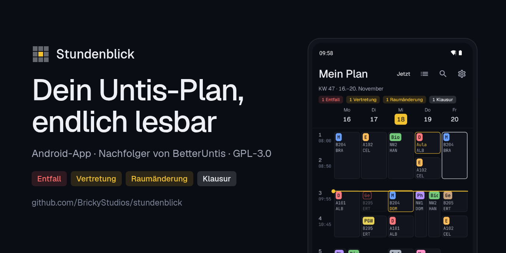
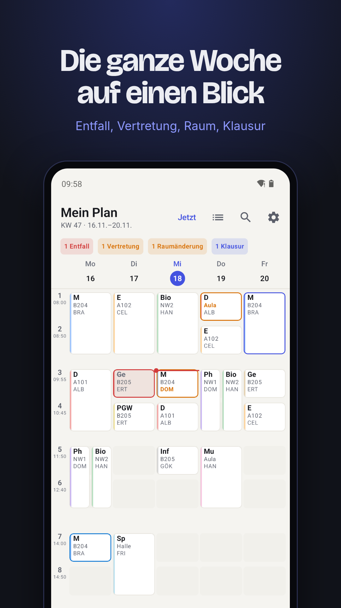
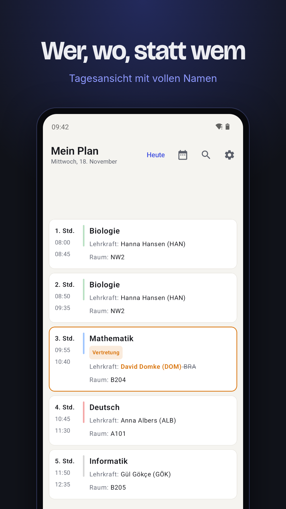
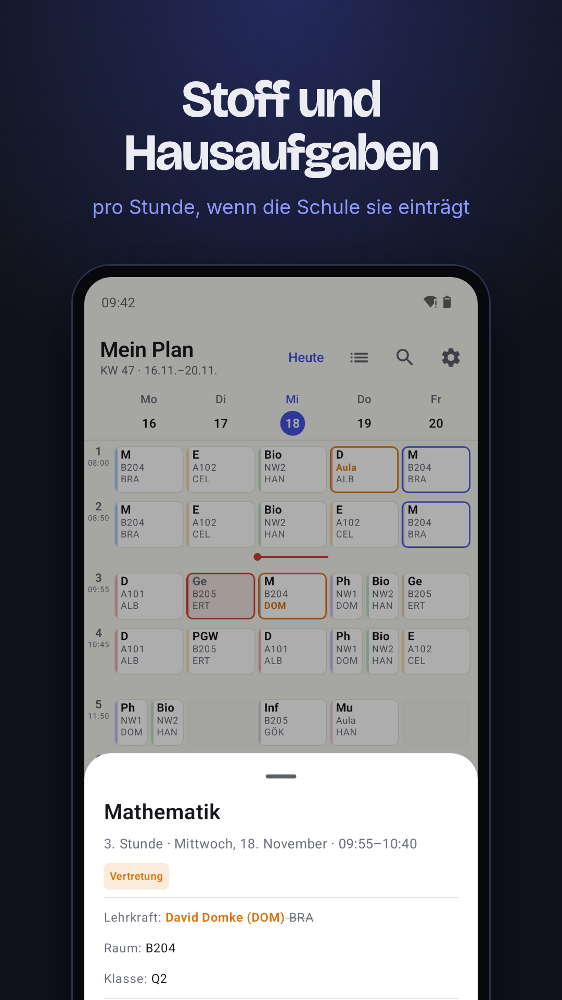
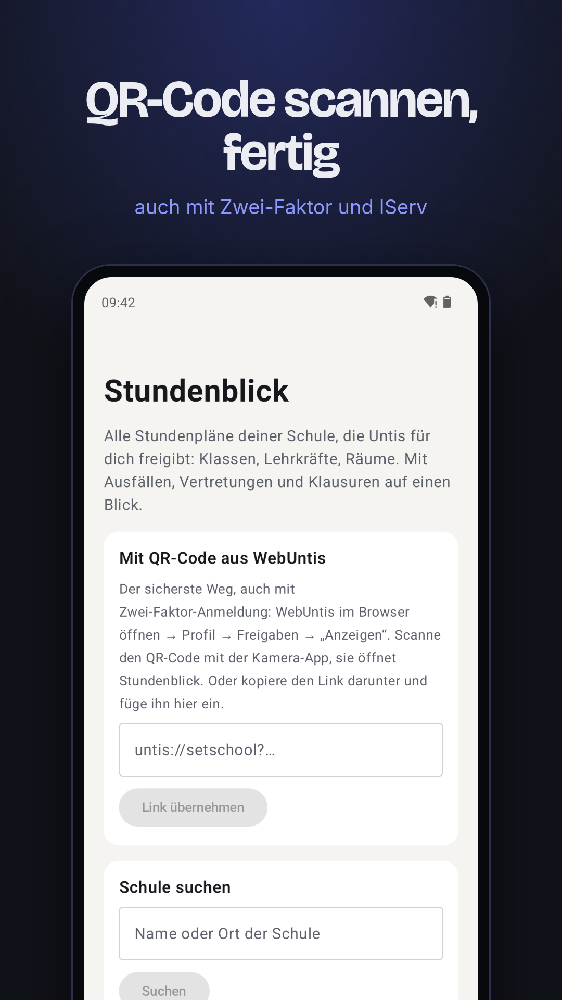

<p align="center"></p>

<h1 align="center">Stundenblick: Untis-Stundenplan-App für Android, quelloffener Nachfolger von BetterUntis</h1>

<p align="center"><strong>Alle Stundenpläne, die deine Schule in WebUntis für dich freigibt: deine Klasse, andere Klassen, Lehrkräfte, Räume. Ausfall, Vertretung, Raumänderung und Klausur sind farbig markiert, Oberstufenkurse lassen sich ausblenden, der Plan bleibt offline lesbar, und eine Meldung kommt, wenn sich etwas ändert. Ohne Tracking, ohne Google-Dienste, GPL-3.0.</strong></p>

<p align="center">
  <a href="https://kotlinlang.org/"></a>
  <br>
  <a href="#installieren"></a>
  <a href="#datenschutz"></a>
  <a href="https://developer.android.com/compose"></a>
  <a href="https://github.com/BrickyStudios/stundenblick/actions/workflows/ci.yml"></a>
  <a href="LICENSE"></a>
  <a href="https://github.com/BrickyStudios/stundenblick/commits/main"></a>
</p>

<p align="center">
  <a href="https://github.com/BrickyStudios/stundenblick/releases/latest/download/Stundenblick.apk"></a>
  <a href="https://brickystudios.github.io/stundenblick/"></a>
</p>

<p align="center">
  
  
  
  
</p>
<p align="center"><sub>Screenshots aus der eingebauten Demo-Schule. Alle Namen dort sind erfunden.</sub></p>

## Warum

[BetterUntis](https://github.com/SapuSeven/BetterUntis) hat seit November 2023 keine stabile Version mehr bekommen. Die Untis-Schnittstelle dahinter läuft weiter (geprüft am 15.11.2026), aber Untis baut um: Konten mit Zwei-Faktor-Anmeldung kommen über Benutzername und Passwort nicht mehr rein, und manche Konten sehen ihren eigenen Plan leer. Stundenblick ist ein neu geschriebener Client für dieselbe Schnittstelle, die auch die offizielle App nutzt.

## Was die App kann

- **Heute-Seite:** jetzige und nächste Stunde mit Raum und Restminuten, Änderungen seit gestern, nach Schulschluss der nächste Schultag, die Woche in Zahlen und der Ferien-Countdown.
- **Jeder freigegebene Plan:** eigene Klasse, andere Klassen, Lehrkräfte, Räume, Fächer, mit Suche und Favoriten. Über fremden Plänen steht, wo die Lehrkraft oder Klasse gerade ist. Namen in den Details öffnen deren Plan.
- **Änderungen auf einen Blick:** Entfall rot und durchgestrichen, Vertretung und Raumänderung orange mit dem alten Namen daneben, Klausur blau, Zusatzstunde hellblau, neue Änderungen mit Punkt markiert.
- **Woche oder Tag:** Wochenraster mit Doppelstunden als Block, Jetzt-Linie und Kursnamen; Tagesliste mit Pausen und Freistunden.
- **Schule auf einen Blick:** alle freien Räume einer Stunde, bis wann sie frei sind und ob sie durch Entfall frei wurden, dazu wer wo Unterricht hat, durchsuchbar nach Klasse, Kurs, Lehrkraft oder Raum. Gibt die Schule Raum- oder Lehrkraftpläne nicht frei, setzt die App sie aus den Klassenplänen zusammen.
- **Raumfinder** wie bei BetterUntis: einzelne Räume wählen und sehen, ob sie jetzt frei sind und bis wann.
- **Info Center** wie bei BetterUntis: Klausuren, Hausaufgaben zum Abhaken, Nachricht des Tages, Sprechstunden mit Mail und Telefon, eigene Fehlzeiten. Was die Schule nicht freigibt, taucht nicht auf.
- **Pausen-Info** wie bei BetterUntis: in jeder Pause still die nächste Stunde mit Raum.
- **Stunden-Details:** Stundeninhalt, Hausaufgaben und Infotext, soweit die Schule sie einträgt.
- **Kurse ausblenden:** in den Einstellungen oder per langem Druck auf eine Stunde, mit Rückgängig.
- **Offline, Meldungen, Widget:** geladene Wochen bleiben gespeichert; einmal pro Stunde meldet die App neue Ausfälle, Vertretungen, Raumänderungen und Klausuren; das Widget zeigt den Tag.
- **Änderungsverlauf** der letzten 60 Tage und ein **Verbindungstest**, der zeigt, welche Infos deine Schule freigibt (Klausuren, Hausaufgaben, Nachrichten, Sprechstunden, Fehlzeiten), ohne Inhalte auszugeben.
- **Demo-Schule:** ausprobieren ohne Konto.

## Was sie nicht kann

- Sie zeigt nur, was deine Schule für dein Konto freigibt. Blendet die Schule Lehrkräfte oder fremde Klassen aus, fehlen sie auch hier.
- Abwesenheiten melden und Nachrichten schreiben fehlen bewusst.
- Nur Android. Eine iOS-Version bräuchte ein Apple-Entwicklerkonto und die App-Store-Prüfung.

## Installieren

1. [`Stundenblick.apk`](https://github.com/BrickyStudios/stundenblick/releases/latest/download/Stundenblick.apk) herunterladen und installieren (Android 8.0 oder neuer). Mit [Obtainium](https://github.com/ImranR98/Obtainium) bleibt sie aktuell, die App kann sich aber auch selbst aktualisieren.
2. Anmelden, am besten per QR-Code: WebUntis im Browser öffnen → Profil → Freigaben → „Anzeigen“. Den QR-Code mit der Kamera-App scannen, sie öffnet Stundenblick. Das klappt auch mit Zwei-Faktor-Anmeldung und mit IServ-Konten.
3. Alternativ die Schule suchen und mit Benutzername und Passwort anmelden, oder ohne Anmeldung, falls deine Schule öffentliche Pläne hat.

**Stand 0.11:** Demo, Schulsuche, anonymer Zugang und alle Ansichten sind auf dem Emulator getestet, die Anmeldung per QR-Code mit einem echten Schulkonto (Microsoft-Anmeldung) ebenfalls. Passwort- und 2FA-Anmeldung sind noch nicht mit echten Konten getestet. Wenn etwas hakt: Einstellungen → Verbindungstest → Kopieren und als [Issue](https://github.com/BrickyStudios/stundenblick/issues) einreichen.

## Datenschutz

- Kein eigener Server, kein Konto, kein Tracking.
- Die App spricht nur mit dem WebUntis-Server deiner Schule und, für Updates, mit GitHub. Die Update-Prüfung lässt sich abschalten.
- Die Ansicht „Schule“ lädt die Klassenpläne erst, wenn du es antippst: eine Anfrage pro Klasse, danach 6 Stunden aus dem Speicher.
- Dein Passwort wird nicht gespeichert, nur der Zugangsschlüssel, den Untis dafür ausgibt. Er liegt im privaten App-Speicher und ist von Backups ausgenommen.

## Selbst bauen

```bash
./gradlew testDebugUnitTest assembleDebug   # JDK 17
```

Die Tests prüfen den Einmal-Code (RFC-6238-Vektoren), den QR-Link inklusive fremder Server, die Fehlertexte, den Parser an der Demo-Schule, den Kursfilter, den Abgleich für Meldungen und dass der Verbindungstest keine Geheimnisse enthält.

## Rechtliches

Stundenblick ist nicht mit der Untis GmbH verbunden. „Untis“ und „WebUntis“ sind Marken der Untis GmbH. Die Schnittstellen-Kenntnisse stammen aus dem Quellcode von [BetterUntis](https://github.com/SapuSeven/BetterUntis) (GPL-3.0) und eigenen Abrufen.

Lizenz: [GPL-3.0](LICENSE)
